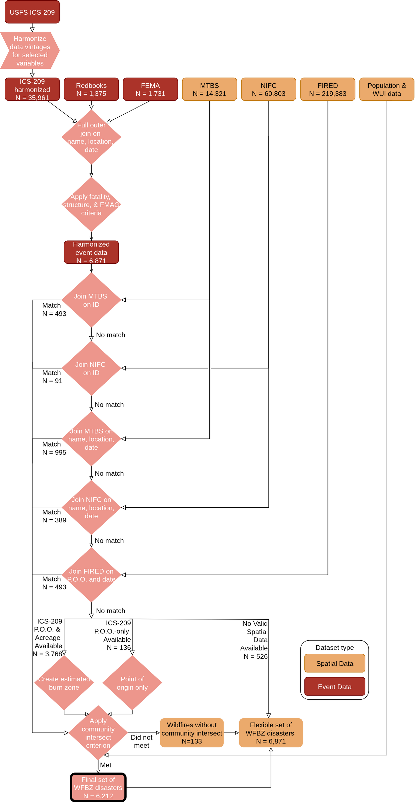

# Wildfire Wildfire Burn Zone Disaster (WFBZ) Data Harmonization

This program will harmonize wildfire and disaster data from several sources to produce a single geospatial data set. 
This project aims to be reproducible for future data releases, with as little manual input as possible.

## Data

The final data product is included in this directory as `wfbz.geojson`. See https://lpiep.github.io/wfbz_disasters_lite/
for a data dictionary and information on input data. 

## Run

Clone this repository. 

```
$ git clone https://github.com/lpiep/wildfire_disasters_lite.git
$ cd wildfire_disasters_lite
```

### System Requirements

* OS: This has been tested on Linux and MacOS. 
* Storage: We recommend at least 100GB free disk space.

### Dependencies

* `conda`
* `R`  

## Environments

Build the conda environment with 
```
conda env create -f wf.yml
conda activate wf
```

Build the R environment by opening R, and running `renv::restore()`. 

```
$ git clone https://github.com/lpiep/wildfire_disasters_lite.git
$ cd wildfire_disasters_lite
```

### Run data pipeline

```
chmod +x ./wfbz_disasters_lite.sh
./wfbz_disasters_lite.sh
```

## Data Sources

### Spatial 

* MBTS - Updated in full from public API automatically when pipeline is run. Source data is
  updated on a rolling basis.
* FIRED - Not expected to be updated. The last available version of the data (through 2022) is downloaded automatically
  if needed. 
* NIFC - Updated in full from public API automatically when pipeline is run. Source data is
  updated on a rolling basis.

### Non-Spatial

* FEMA Disaster Declarations - Updated in full from public API automatically when pipeline is run. Source data is
  updated on a rolling basis.
* ICS-209
  * Data is pulled automatically from https://github.com/lpiep/ics209_minimal automatically when pipeline is run. 
  * The ICS209_minimal repository is configured to update itself automatically. Historical data is archived in that
    repository. More recent data is pulled monthly from a USFS private API (instructions for access are included in
    the README). Each year, however, an archive containing more variables than the API is released. This can be downloaded
    and added to the archived data, although the archives' data formatting changes periodically and this may require
    custom coding. 
* REDBOOKS 
  * Email CalFire each year to obtain last year's data file. See
    [2023](https://github.com/lpiep/wfbz_disasters_lite/blob/main/data/01_raw/event/redbook/redbook_2023_combined_csv.csv)
    for an example of the expected file naming convention and contents. Once added to the data folder, the new data will
    be included into the data pipeline. 

### Updating Docs

This repo has a documentation website at https://lpiep.github.io/wildfire_disasters_lite/.

It is created using `mkdocs` which is included in the `wf` conda environment. Make changes to 
the markdown files at `docs-site/docs/` to update content, and to the YML file at `docs-site/mkdocs.yml`
to update the site structure or add pages. 

To apply updates to the GH Pages site, run `mkdocs gh-deploy -f docs-site/mkdocs.yml`. Docs are also 
deployed when pushed to main. 


### Process


